# Persistencia de api-real-jaen: diseño (SQLite, SQLAlchemy, Alembic)

> Estado 29-10-2026: fases 0 a 4 implementadas y en uso; la base de la instalación habitual está en la revisión
> `0004` ([fase4-sincronizacion.md](fase4-sincronizacion.md)).

**Estado: diseño aprobado como orientación, revisado con precisiones (24-10-2026).** Fases 0 a 3 implementadas
(resultados en la sección 6). La revisión crítica de simplicidad tras la fase 3 está en
`docs/revision-simplicidad-persistencia.md`. Fase 4 (importación incremental con sincronización completa) implementada
sin activar en la base real: `docs/fase4-sincronizacion.md`.
La coordinación cooperativa API/mantenimiento y sus límites están en la sección 11 de ese documento;
la API mantiene un bloqueo de proceso aunque cierre su conexión tras cargar la instantánea.

Decisiones acordadas:
- SQLite al principio, SQLAlchemy como ORM y Alembic para migraciones; uso individual.
- Identificadores internos estables y correspondencias verificadas por proveedor.
- Originales, versiones y procedencia conservados.
- Estadísticas por partido como base; agregados reconstruibles con cobertura.
- Servicios futuros (vídeo) con persistencia propia e identificadores comunes.
- La base vive **fuera del repositorio**.
- **JSON es el almacenamiento predeterminado** durante la migración.
- **Sin recarga en caliente** al principio.
- **Retirada de ficheros aplazada**.
- Un fichero **puede declarar varios equipos** si cada declaración se registra y valida
  explícitamente.
- Se **mantienen los nombres actuales** por equivalencia.
- **`/health` no cambia** en esta fase.

Índice:
1. Revisión del sistema actual
2. Modelo de datos
3. Coherencia y normalización
4. Importación y actualización
5. Compatibilidad y aislamiento de SQLite
6. Plan por fases
7. Validación de equivalencia
8. Cuestiones pendientes

---

## 1. Revisión del sistema actual

### 1.1 Estado comprobado (solo lectura, 24-10-2026)

- **Repositorio**: rama `feature/stats-normalization` (commit `f456fd4`, sin fusionar en
  `master`). Cambios locales: solo este documento y su referencia en `README.txt`.
- **Instrucciones de agente**: no existe `AGENTS.md` ni `CLAUDE.md` en `api-real-jaen` ni en sus
  antecesores (`C:\Users\broke\dev`, `C:\Users\broke`, `C:\Users`, `C:\`), ni configuración de
  usuario equivalente. Las de `rj-analyst` (repositorio hermano) **no se heredan**: aquí rigen las
  instrucciones explícitas de cada tarea.
- **Servicio activo** (no se ha tocado):
  - `api.py --datos …\fichas-grupo2-2026-10-23\importacion-001 --ambito api-real-jaen\ambito.json
    --sustituciones api-real-jaen\correcciones\sustituciones.json --port 8001`;
  - Python 3.14 (el `python.exe` de WindowsApps lanza el intérprete);
  - lo consume el dashboard (`next dev`, puerto 3000).
- **Importación activa** (formato 2, `imported_at` 2026-10-23T14:50:48Z):

| Archivo | Registros | Notas |
|---|---|---|
| `originales.json` | 1806 líneas | 873 secciones, 873 `selected`, 845 huellas distintas. Por clave: event 807, h2h 171, incidents 171, team_streaks 171, statistics 169, lineups 168, pregame_form 147, listing 2. `sub` siempre `''`; 2 `fetched_at` inválidos (los dos `listing`); el sobre de cada línea solo trae `event_id`, `key`, `sub`, `fetched_at`, `payload` |
| `exportaciones.json` | 24 ficheros distintos (sha256 y nombres únicos) | 21 raw con equipo declarado (20 equipos), 1 calendario `listing`, 2 de fichas |
| `fichas_originales.json` | 532 fichas | 532 jugadores |
| `partidos.json` | 393 | 391 `event`, 2 `listing`. Por estado: 308 notstarted, 83 finished, 2 postponed. Por competición: Grupo 2 382, Copa del Rey 8, Copa Federación 3 |
| `jugador_partido.json` | 3427 | 3403 con estadísticas, 26,9 claves de media (91 708 valores) |
| `jugadores.json` / `equipos.json` | 532 / 30 | |
| `discrepancias.json` | 0 | |
| `resumen.json` | — | 94 avisos (`teamId` de origen distinto del lado) |

- **Lo servido** con el ámbito y las sustituciones activos: 382 partidos (11 excluidos), 3427
  convocatorias, 532 jugadores (0 excluidos), 30 equipos y 2 sustituciones locales
  (16599919 → 16969545, 16599956 → 17118209).
- **Los datos activos no tienen** discrepancias, versiones contradictorias, duplicados ni valores
  inválidos en las secciones: esos caminos se validarán con casos sintéticos (7.3).

### 1.2 Endpoints y contratos que consume el dashboard

El dashboard (`rj-analyst`, `src/server/local-api/local-api-source.ts`) usa todas las rutas salvo
`/health`. Todas son `GET`, sin parámetros de consulta (con consulta: 400).

| Ruta | Lo que usa el dashboard |
|---|---|
| `/api/v1/scope` | competiciones (`unique_tournament_id`, `tournament_id`, `season_id`, `name`, `season`), `teams_with_own_export`, `matches {events, current, replaced_locally}`, `local_replacements` |
| `/api/v1/teams/{id}` | `name` |
| `/api/v1/teams/{id}/players` | `player_id`, `name`, `usual_position`; `meta.scope`, `meta.count` |
| `/api/v1/teams/{id}/matches` | partidos vigentes (todos sus campos, incluidos `replaces`) y `meta.replaced_locally` |
| `/api/v1/teams/{id}/performance` | `matches` (recuentos), `record`, `venues`, `results`, `output` con `{value, matches, of}` |
| `/api/v1/teams/{id}/player-stats` | `call_ups` (recuentos), `players[]` con `{value, matches, of}` |
| `/api/v1/players/{id}` | ficha: `name`, `usual_position`, `country`, `birth_date`, `height_cm`, `preferred_foot` |
| `/api/v1/players/{id}/matches` | cada convocatoria con `match`, `side`, `substitute`, `match_position`, `statistics` original, `normalized` (participación, minutos, goles, asistencias, `stats`) |
| `/api/v1/matches/{id}` | partido + nombres; `meta.sections` |
| `/api/v1/matches/{id}/statistics\|lineups\|incidents` | **payload original sin transformar**, `meta.availability`, `meta.fetched_at`; en lineups, `normalized.players` |

### 1.3 Identificadores, ordenación, errores y cobertura

- **Identificadores públicos de la API**: los enteros de SofaScore (`team_id`, `player_id`,
  `match_id`).
  - El dashboard deriva de ellos los suyos: `sofascore-player-N`, `sofascore-match-N`,
    `sofascore-team-N`, `team-real-jaen` = 2841, `sofascore-scope-{tournament_id}-{season_id}`.
  - Los escudos dependen de esa correspondencia.
  - **No pueden cambiar.**
- **Ordenación actual** (implícita en los JSON): `partidos` por `match_id`; `jugador_partido` por
  (`match_id`, `team_id`, `player_id`); `jugadores` por `player_id`; `equipos` por `team_id`.
  - `/teams/{id}/matches` sale **por `match_id`**, no por fecha.
  - `results` de rendimiento sale por instante de inicio (a igualdad, `match_id`; sin fecha, al
    final).
  - `player-stats` sale por `player_id`.
  - Las claves de cada `statistics` conservan el orden del original.
  - En SQL, cada orden ha de ser un `ORDER BY` o un ordinal explícito.
- **Errores**:
  - 400: `Identificador inválido` (no entero) y `Esta versión no admite filtros de consulta.`
  - 404: `Ruta inexistente`, `Entidad no encontrada`, `Partido no encontrado`, `Partido fuera del
    ámbito de esta versión`, `Jugador fuera del ámbito de esta versión`.
  - Un ámbito o unas sustituciones inválidos impiden arrancar.
- **Cobertura**:
  - `{value, matches, of}`: sin dato, `value: null`, nunca 0;
  - secciones `stored | empty | not_stored`; `meta.versions`, `meta.discrepancy`;
  - recuentos de partidos `in_scope`, `counted`, `finished_without_valid_score`,
    `excluded_by_version_conflict`, `replaced_locally`…

### 1.4 Dependencias de archivos JSON

| Lector | Archivos |
|---|---|
| `api.cargar` | obligatorios: `equipos`, `jugadores`, `partidos`, `jugador_partido`; opcionales: `originales`, `exportaciones`, `discrepancias`, `fichas_originales`. Aparte, `ambito.json` (obligatorio) y `sustituciones.json` (opcional) |
| `importar.py` | entradas JSONL (raw, calendario `events`, fichas); salida, una carpeta nueva completa |
| Pruebas | `tests/fixtures/datos` (muestra sintética versionada) y `datos/` para `test_exportacion` |

### 1.5 Separación actual de responsabilidades

| Etapa | Dónde | Qué hace |
|---|---|---|
| Lectura y procedencia | `importar.leer_*` | líneas con exportación, línea, huella e instante |
| Resolución de versiones | `importar.seleccionar` (al importar) | versión operativa por (evento, clave, sub) y discrepancias. La API **confía** en `selected` (`api.indexar`) |
| Extracción | `importar.transformar` | partidos, equipos, convocatorias y fichas desde lo seleccionado |
| Ámbito y decisiones locales | `api.aplicar_ambito`, `api.aplicar_sustituciones` (al arrancar) | filtra y marca; rehace la ficha de jugadores con convocatorias excluidas |
| Normalización | `api.actuacion`, `estadisticas_de_actuacion` (al consultar) | participación, minutos, goles, asistencias, `stats` |
| Agregados | `api.rendimiento`, `acumulados_jugadores` (al consultar) | balance, producción, acumulados con cobertura |

### 1.6 Duplicaciones y acoplamientos que afectan a la migración

1. **Etiquetas de exportación posicionales**: `E1…E24` dependen del orden de los argumentos de cada
   reimportación y se publican (`exports` de cada partido, `versions[].export` en la evidencia).
2. **Estadísticas copiadas**: `jugador_partido.statistics` copia la entrada de la alineación
   seleccionada, que ya está en `originales.json`.
3. **Ficha calculada dos veces con la misma función**, y dependiente del ámbito
   (`ficha_de_alineaciones`).
4. **Instantáneas derivadas en `partidos.json`** que se publican: `available_sections`, `exports`,
   `fetched_at`, `version_conflict`, `version_issues` y la `season` de un `listing`.
5. **Desempates por orden de lectura**:
   - `mas_reciente` desempata a igual instante por la posición en la entrada;
   - `equipos.setdefault` se queda con el **primer** nombre visto.
6. **Discrepancias calculadas solo por el importador**. La API publica las de sección; las de
   atributos de jugador no se sirven.
7. **Ámbito aplicado al cargar**; `equipos` no se filtra (`/teams/{id}` responde para equipos de
   Copa).
8. **Duplicados legados**: el importador actual rechaza un jugador repetido en una alineación, pero
   la API sigue uniendo registros duplicados de convocatoria (`comun`, `duplicate_records`).
9. **Todo en memoria y sin dependencias**: la normalización se recalcula en cada petición.
10. **Extracción mezclada con el ensamblado**: la extracción de convocatorias vive dentro de
    `transformar`. Para que importador JSON y base usen la misma función hay que **separarla**
    (sin cambiar su comportamiento) antes de la fase 2.

---

## 2. Modelo de datos

### 2.1 Principios

- **Cuatro capas**:

| Capa | Contenido | ¿Se reconstruye? |
|---|---|---|
| Identidad | entidades con `uid`, correspondencias por proveedor y decisiones de identidad | **No**: son decisiones. Se conservan en toda reconstrucción y se exportan con las copias |
| Evidencia | ficheros, observaciones, contenidos originales | No: inmutable |
| Declaraciones y decisiones locales | equipo propio de un fichero, sustituciones | No: decisiones auditadas, con alta y baja |
| Estado operativo | versión seleccionada, partido, convocatorias, extracciones, discrepancias | **Sí**, desde evidencia + identidad + declaraciones, con una versión de reglas identificada |

- **Configuración fuera de la base**: `ambito.json`, el código de las reglas, la ruta de la base y
  el modo de almacenamiento.
- **Sin bloques de archivo.** No se guardan `partidos.json` ni `jugador_partido.json` como textos.
  El único JSON guardado tal cual es el **payload original de cada observación**: es la evidencia y
  se sirve sin transformar. Se usan columnas JSON en tres casos justificados:
  - valores de la fuente cuyo **tipo** importa (`true` frente a `1`, `null` frente a ausente), que
    una columna numérica de SQLite no distingue;
  - listas cortas que solo se publican;
  - informes de ejecución.
- **Identificadores externos siempre como texto**, también en observaciones y extracciones (2.3).
- **Ninguna unión automática por nombre.**

### 2.2 Diagrama

```mermaid
erDiagram
    PLAYER ||--o{ PLAYER_EXTERNAL_ID : "se identifica en"
    PLAYER |o--o{ PLAYER : "merged_into"
    IDENTITY_DECISION ||--o{ IDENTITY_DECISION_SUBJECT : "afecta a"
    TEAM ||--o{ TEAM_EXTERNAL_ID : ""
    MATCH ||--o{ MATCH_EXTERNAL_ID : ""
    COMPETITION ||--o{ COMPETITION_EXTERNAL_ID : ""
    SEASON ||--o{ SEASON_EXTERNAL_ID : ""
    STAGE ||--o{ STAGE_EXTERNAL_ID : ""
    COMPETITION ||--o{ SEASON : "temporadas"
    COMPETITION ||--o{ STAGE : "etapas"

    IMPORT_RUN ||--o{ IMPORT_RUN_FILE : "presenta"
    SOURCE_FILE ||--o{ IMPORT_RUN_FILE : "presentado en"
    SOURCE_FILE ||--o{ FILE_TEAM_DECLARATION : "declarado propio de"
    TEAM ||--o{ FILE_TEAM_DECLARATION : ""
    SOURCE_FILE ||--o{ OBSERVATION : "líneas"
    CONTENT ||--o{ OBSERVATION : "payload"

    OBSERVATION ||--o{ SECTION_SELECTION : "seleccionada"
    MATCH ||--o{ SECTION_SELECTION : ""
    RULE_SET ||--o{ SECTION_SELECTION : "según"
    DISCREPANCY ||--o{ DISCREPANCY_REASON : ""
    DISCREPANCY ||--o{ DISCREPANCY_OBSERVATION : ""

    MATCH ||--|| MATCH_STATE : "estado"
    TEAM ||--o{ MATCH_STATE : "local / visitante"
    OBSERVATION ||--o{ CALL_UP : "entrada de alineación"
    CALL_UP ||--o{ CALL_UP_STAT : "claves originales"
    OBSERVATION ||--o{ TEAM_MATCH_STAT : ""
    OBSERVATION ||--o{ INCIDENT : ""
    OBSERVATION ||--o{ PLAYER_ATTRIBUTE_OBSERVATION : ""
    TEAM ||--o{ TEAM_NAME : ""

    MATCH ||--o{ LOCAL_REPLACEMENT : "sustituido / vigente"
```

### 2.3 Identidad

**Tablas de entidad**: `team`, `player`, `match`, `competition`, `season`, `stage`.

| Columna | Tipo | Notas |
|---|---|---|
| `id` | INTEGER PK | solo para uniones internas; nunca se publica ni se reutiliza |
| `uid` | TEXT UNIQUE NOT NULL | identificador estable compartido con otros servicios (vídeo) |
| `status` | CHECK `active`, `merged` | |
| `merged_into_id` | FK a la misma tabla, NULL | CHECK: NOT NULL si y solo si `status = 'merged'` |
| `created_in_run` | FK `import_run` | |

- `season.competition_id` y `stage.competition_id` son FK.
- `season.label` es la temporada como la nombra la fuente.

**Asignación del `uid`**:
- Se calcula **una sola vez**, al crear la entidad: UUIDv5 de un espacio de nombres propio y del
  identificador externo de origen (`sofascore:player:966303`).
- Desde entonces es un dato: nunca se recalcula ni cambia, aunque la entidad se fusione, se divida
  o pierda esa correspondencia.
- Una entidad creada al dividir otra (2.3.2) recibe el UUIDv5 de su propio nombre de decisión
  (`split:<uid de la decisión>:<n>`), también una sola vez.

#### 2.3.1 Identificadores externos y su ámbito de unicidad

Una tabla por tipo de entidad (`player_external_id`, `team_external_id`, `match_external_id`,
`competition_external_id`, `season_external_id`, `stage_external_id`), para que la FK sea real.

| Columna | Notas |
|---|---|
| `provider` | TEXT NOT NULL (`sofascore`, futuros proveedores) |
| `namespace` | TEXT NOT NULL DEFAULT `''`: ámbito en el que el proveedor garantiza unicidad |
| `external_id` | **TEXT** NOT NULL, tal cual (para SofaScore, entero en decimal canónico, sin ceros a la izquierda: CHECK por proveedor en la aplicación) |
| `entity_id` | FK NOT NULL |
| `status` | CHECK `origin` (la entidad nació de este id), `verified` (asociación decidida), `rejected` (anulada: se conserva) |
| `decision_id` | FK `identity_decision`, NOT NULL salvo `origin` |
| `created_in_run` | FK |

- Índice único (`provider`, `namespace`, `external_id`) WHERE `status` <> 'rejected': un id
  externo vivo apunta a una sola entidad.
- Índice (`entity_id`).

**Ámbito de unicidad** (unicidad por proveedor y tipo, más `namespace` cuando el proveedor no
garantiza ids globales):

| Tipo | SofaScore: id y ámbito | Notas |
|---|---|---|
| `competition` | `uniqueTournament.id`, global (`namespace ''`) | 17073 = Primera Federación (ambos grupos) |
| `stage` | `tournament.id`, global | el grupo (94191). Un id de copa puede repetirse entre temporadas, así que la etapa no se ata a una temporada |
| `season` | `season.id`, global; **se valida** que siempre aparezca con la misma `uniqueTournament.id` | 97382 («26/27») pertenece a 17073. Si apareciera con otra competición: error de importación, nunca una unión silenciosa. Un proveedor con ids de temporada por competición usará `namespace` = id externo de la competición |
| `team`, `player`, `match` | ids globales | |

- En un `listing`, `tournament_id` es la competición general y `stage.id` el grupo: la extracción
  conserva esa diferencia, como hoy.

**Identificadores externos en evidencia y extracciones, como texto**:
- `observation.external_event_id`, `observation.external_player_id`;
- `call_up.external_team_id` (el `teamId` original), `call_up.external_player_id`;
- `incident.external_player_id`, `external_assist1_id`, `external_player_in_id`,
  `external_player_out_id`;
- `match_state` conserva los ids externos de equipos y competición tal como llegaron.

Los ids resueltos (`*_id` FK) van al lado y pueden ser NULL si aún no hay correspondencia: el id
externo nunca se sustituye por el interno.

**Traducción para la API**:
- Un id público se busca en `*_external_id` con `provider = 'sofascore'`, `namespace = ''` y estado
  vivo, y se sigue `merged_into_id` hasta la entidad activa.
- Al publicar, la entidad responde con **su** id de origen. Con una sola correspondencia por
  entidad, que es el caso actual, el resultado es idéntico al de hoy.

#### 2.3.2 Corrección y unificación de identidades

No se implementa ninguna herramienta en esta fase, pero el esquema no la impide y la reconstrucción
la respeta.

- **`identity_decision`**: `id`, `uid`, `kind` CHECK `merge`, `split`, `reassign_external_id`,
  `reject_external_id`, `revert`; `entity_type`; `reason`, `decided_by`, `decided_on`,
  `evidence` NOT NULL; `run_id`; `reverts_decision_id` FK NULL.
- **`identity_decision_subject`** (`decision_id`, `role`, `entity_id`, `external_id_row`): quién
  queda afectado y cómo.
- **Fusionar B en A**:
  - B pasa a `merged`, con `merged_into_id = A`;
  - las correspondencias de B **no se mueven**: siguen apuntando a B y se resuelven a A;
  - el `uid` de B sigue publicado y resoluble, como redirección.
  - Las cadenas se comprimen al decidir: `merged_into_id` siempre apunta a una entidad activa
    (comprobación de aplicación en la misma transacción).
- **Separar una correspondencia mal asignada**: el id externo pasa a `rejected` y una nueva fila
  `verified` apunta a otra entidad, existente o creada. Nada se borra.
- **Revertir**: una decisión `revert` restablece el estado anterior; la decisión original se
  conserva.
- **Referencias**:
  - La evidencia y el estado operativo guardan el **id externo** y la entidad resuelta en su
    momento.
  - La lectura resuelve siempre a la entidad activa (`merged_into_id`).
  - Un `rebuild` vuelve a resolver los ids externos con las correspondencias vigentes; las
    decisiones de identidad no se recalculan nunca.
- **Si se perdiera la base**: una reconstrucción solo desde la evidencia reproduce las entidades de
  origen con sus mismos `uid` (UUIDv5), pero **no** las decisiones. Por eso las copias exportan
  `identity_decision` y sus sujetos como fichero de decisiones reaplicable, igual que las
  sustituciones (fase 5).

### 2.4 Evidencia

**`content`**:

| Columna | Notas |
|---|---|
| `hash` | PK: SHA256 del JSON canónico, la misma `huella` de hoy |
| `payload_text` | TEXT NOT NULL: el payload serializado **conservando el orden de claves del original**, sin espacios (`ensure_ascii=False`) |
| `text_sha256` | huella del texto guardado |
| `bytes` | |

- Deduplicado: 845 contenidos para 1806 líneas.
- CHECK de JSON válido (2.7).

**`source_file`** (identidad del contenido del fichero; todo lo que no depende de cómo se presentó):

| Columna | Notas |
|---|---|
| `id` | PK |
| `sha256` | UNIQUE NOT NULL. **Idempotencia**: el mismo contenido es el mismo fichero, se llame como se llame |
| `kind` | CHECK `raw`, `listing`, `player_profile`, `local_decisions`, `identity_decisions` |
| `label` | UNIQUE NOT NULL (`E1`…): se asigna **una vez**, en la primera ingestión, y se conserva |
| `records`, `events`, `players`, `invalid_fetched_at`, `without_profile`, `fetched_from`, `fetched_to` | calculados del contenido |
| `first_run_id` | FK |

La retirada de ficheros está aplazada: no hay columna de estado. Se añadirá con una migración cuando
se decida.

**`import_run_file`** (cómo se presentó un fichero en cada ejecución):
- Columnas: `run_id`, `source_file_id`, `position`, `presented_name`, `presented_path`, `outcome`
  (CHECK `ingested`, `already_known`).
- PK (`run_id`, `source_file_id`).
- El nombre y la ruta son metadatos de importación, no identidad.

**`file_team_declaration`** (declaraciones auditadas, separadas del contenido):

| Columna | Notas |
|---|---|
| `id` | PK |
| `source_file_id` | FK NOT NULL |
| `team_id` | FK NOT NULL |
| `external_team_id` | TEXT: lo declarado (`EQUIPO=RUTA`) |
| `status` | CHECK `active`, `withdrawn` |
| `declared_in_run` | FK NOT NULL |
| `declared_by` | |
| `withdrawn_in_run`, `withdrawn_by`, `withdrawn_reason` | obligatorios si `withdrawn` (CHECK) |

- Índice único (`source_file_id`, `team_id`) WHERE `status` = 'active'.
- **Validación explícita al declarar**: el fichero es `raw` y el equipo aparece como local o
  visitante en al menos un `event` del propio fichero. Si no, la declaración se rechaza y la
  ejecución falla sin escribir.
- **Varios equipos por fichero**: se admite; cada equipo es una declaración propia, validada y
  registrada.
- **Un fichero ya conocido con una declaración nueva**: la ejecución registra `already_known`,
  **no añade observaciones** y crea la declaración. Retirar una declaración es otra fila
  auditada; nada se borra.
- `teams_with_own_export` sale de las declaraciones activas.

**`observation`** (cada línea de entrada; sustituye a los registros de `originales.json` y
`fichas_originales.json`):

| Columna | Notas |
|---|---|
| `id` | INTEGER PK: **orden de ingestión**, global y creciente (desempates de 4.3) |
| `source_file_id` | FK NOT NULL |
| `line` | INTEGER NOT NULL |
| `kind` | CHECK `section`, `listing`, `player_profile` |
| `provider` | |
| `external_event_id` | TEXT NULL |
| `external_player_id` | TEXT NULL |
| `key` | TEXT NOT NULL |
| `sub` | TEXT NOT NULL DEFAULT `''` |
| `endpoint` | TEXT NULL |
| `fetched_at_raw` | TEXT NULL, tal cual |
| `fetched_instant` | TEXT NULL, UTC normalizado |
| `fetched_at_valid` | BOOLEAN NOT NULL |
| `content_hash` | FK NOT NULL |
| `envelope_extra` | JSON NULL: otros campos del sobre de la línea (hoy ninguno), para no perder nada |
| `match_id`, `player_id` | FK NULL: la entidad resuelta |

- Restricciones: UNIQUE (`source_file_id`, `line`); CHECK de coherencia entre `kind` y los ids.
- Índices: (`match_id`, `key`, `sub`), (`provider`, `external_event_id`, `key`, `sub`),
  (`player_id`), (`content_hash`).

### 2.5 Estado operativo (reconstruible)

Todas estas tablas llevan `rule_set_id` y `run_id`.

**`rule_set`**: `id`, `name`, `version`, `code_ref` (commit o huella del código), `description`.
Por ejemplo: `importar.seleccionar@2`, `extraer_convocatorias@1`, `ficha_combinada@1`.

**`section_selection`**:
- Columnas: `match_id`, `key`, `sub`, `observation_id`, `versions`. PK (`match_id`, `key`, `sub`).
- **`section_selection_history`** (`valid_from_run`, `valid_to_run`) guarda las selecciones
  anteriores. Su alcance real está en 3.5.

**`discrepancy`**:

| Columna | Notas |
|---|---|
| `id` | PK |
| `kind` | CHECK `section`, `listing_vs_event`, `player_attribute` |
| `match_id` / `player_id` | según `kind` |
| `key`, `sub` | |
| `integrity` | BOOLEAN |
| `selected_observation_id` | FK NULL |
| `changed_fields` | JSON: lista corta de nombres de campo, solo publicada |
| `run_id`, `superseded_in_run` | vigencia |

Hijas: `discrepancy_reason`, `discrepancy_observation` (todas las versiones) y `discrepancy_value`
(para atributos de jugador).

**`match_state`**:

| Columna | Notas |
|---|---|
| `match_id` | PK |
| `stage_id`, `season_id`, `competition_id` | FK NULL |
| `external_*` | los ids externos tal como llegaron |
| `competition_name`, `season_label` | como los da la fuente |
| `status` | TEXT NULL, tal cual |
| `kickoff_utc` | |
| `round` | JSON |
| `home_team_id`, `away_team_id` | FK NOT NULL |
| `home_score`, `away_score` | JSON (tipo original) |
| `calendar_source` | CHECK `event`, `listing` |
| `version_conflict` | BOOLEAN |
| `source_observation_id` | FK |

- Hija `match_version_issue` (`match_id`, `reason`).
- `available_sections` y `exports` se consultan, no se guardan.

**`team_name`** (`team_id` PK, `name`, `source_observation_id`): nombre publicado con la regla
actual (primero visto en orden de ingestión), mantenida por equivalencia.

**`call_up`**: cada entrada de jugador de la alineación seleccionada.

| Columna | Notas |
|---|---|
| `id` | PK |
| `lineup_observation_id` | FK NOT NULL |
| `entry_index` | posición en el payload |
| `side` | CHECK `home`, `away` |
| `match_id`, `team_id` | FK NOT NULL; `team_id` es el equipo del lado |
| `external_player_id` | TEXT NOT NULL |
| `player_id` | FK NULL |
| `external_team_id` | TEXT NULL (el `teamId` original) |
| `substitute`, `shirt_number`, `minutes_played` | JSON (tipo original) |
| `match_position` | TEXT NULL |
| `played` | BOOLEAN NULL |

- UNIQUE (`lineup_observation_id`, `side`, `entry_index`).
- **No** hay UNIQUE (`match_id`, `team_id`, `player_id`): la unicidad de jugador por alineación
  es una regla del importador (hoy rechaza la importación). No es una restricción del esquema, así
  que un caso legado o sintético con duplicados se puede representar y la normalización los une,
  como hoy.
- Índices: (`match_id`, `player_id`), (`player_id`).

**`call_up_stat`**:
- Columnas: `call_up_id`, `ordinal`, `key`, `value_json`. PK (`call_up_id`, `key`); UNIQUE
  (`call_up_id`, `ordinal`).
- Cada clave presente con su literal JSON y su **posición original**.
- Ausente = sin fila; `null` = `'null'`; un inválido se guarda tal cual.

**`team_match_stat`**:
- Columnas: `observation_id`, `period`, `group_index`, `item_index`, `group_name`, `key`,
  `statistics_type`, `home_value`, `away_value`, `home_total`, `away_total` (los cuatro valores en
  JSON).
- Se conservan las claves repetidas entre grupos.

**`incident`**: `observation_id`, `seq`, `incident_type`, `incident_class`, `is_home` (JSON), los
ids externos y sus FK resueltas, `time`, `added_time`.

**`player_attribute_observation`**:
- Columnas: `observation_id`, `player_id`, `external_player_id`, `field`, `value_json`,
  `fetched_instant`.
- Guarda los atributos **conocidos** de cada entrada de alineación (todas las versiones) y de cada
  ficha.
- La ficha se combina **al consultar** (depende del ámbito).

### 2.6 Decisiones locales

**`local_replacement`**:

| Columna | Notas |
|---|---|
| `id` | PK |
| `replaced_match_id`, `current_match_id` | FK; CHECK distintos |
| `external_replaced_id`, `external_current_id` | TEXT |
| `reason`, `decided_by` | |
| `decided_on` | DATE |
| `evidence` | |
| `source_file_id` | el archivo de decisiones del que se incorporó, con su sha256 |
| `created_in_run` | |
| `status` | CHECK `active`, `reverted` |
| `reverted_in_run`, `reverted_by`, `reverted_on`, `revert_reason` | obligatorios si `reverted` |

- Índice único (`replaced_match_id`) WHERE `status` = 'active'.
- Validaciones de hoy al escribir y al arrancar la API.
- Revertir no borra.

### 2.7 Preservación íntegra de las secciones originales

- Las rutas `/matches/{id}/statistics|lineups|incidents` sirven **siempre** el payload de
  `content.payload_text` de la observación seleccionada. **Nunca** se reconstruyen desde las tablas
  extraídas, que solo representan algunos campos y sirven para consultar, indexar y comprobar.
- **Orden de claves**: `payload_text` conserva el orden del original. Hoy la respuesta mantiene el
  orden porque `json.loads` lo conserva, así que la respuesta en modo SQL es la misma, no solo
  equivalente.
  - Si dos observaciones con el mismo contenido canónico difieren solo en el orden de claves,
    comparten fila con el orden de la primera. La diferencia se detecta por `text_sha256` y se
    documenta; en los datos activos no ocurre.
  - La sincronización deriva convocatorias y `call_up_stat.ordinal` de esa representación guardada,
    no del orden de la entrada nueva: si no, la importación calculaba ordinales con un orden y la
    verificación previa al COMMIT los releía con el otro, y rechazaba la importación (detectado el
    27-10-2026 con 3403 grupos discrepantes). Prueba: `tests/test_orden_payload.py`.
- **Números**:
  - el texto guardado es el que produce `json.dumps` del valor leído, igual que hoy al servir;
  - los enteros grandes y los decimales se conservan (Python serializa los `float` con su
    representación exacta más corta);
  - `NaN` o `Infinity` en un original harían fallar la respuesta igual que hoy (`allow_nan=False`):
    se registran como error de importación, sin alterar el contenido.
- **El `statistics` de cada convocatoria** (servido en `/players/{id}/matches`) se toma también de
  la entrada original del payload. `call_up_stat` con `ordinal` es la copia extraída y se verifica
  idéntica en orden y valores.
- **Una sola extracción**: importador JSON y base usan la misma función
  `extraer_convocatorias(observación)`, separada de `transformar` sin cambiar su comportamiento
  (1.6.10).

---

## 3. Coherencia y normalización

### 3.1 Qué se almacena y qué se calcula al consultar

| Resultado | Dónde | Motivo |
|---|---|---|
| Observaciones, contenidos, ficheros | almacenado, inmutable | evidencia |
| Identidad, declaraciones, sustituciones | almacenado, decisiones auditadas | no se recalculan |
| Selección, discrepancias, estado del partido, convocatorias y extracciones, nombres | **materializado** con `rule_set` | extracción determinista de la evidencia |
| Ámbito | **al consultar** (configuración) | cambia sin reimportar |
| Efecto de las sustituciones | al consultar | como hoy |
| Ficha combinada | **al consultar** | depende del ámbito |
| Participación, minutos, goles, asistencias, `normalized.stats` | **al consultar** (`api.actuacion`) | una sola implementación |
| Rendimiento, producción, acumulados con cobertura | **al consultar** | sin caché en la primera fase |

### 3.2 Una sola implementación de cada regla

- La lectura SQL construye la misma estructura `datos` que `cargar` y `consultar(datos, ruta)` no
  cambia.
- `seleccionar`, `extraer_convocatorias`, `ficha_combinada`, `actuacion`,
  `estadisticas_de_actuacion`, `rendimiento` y `acumulados_jugadores` siguen siendo las únicas
  implementaciones: la base las importa, no las reescribe.
- Optimizar consultas (xG incluido) queda fuera.

### 3.3 Valores, motivos y evidencia

- **Participaciones sin resolver**: `unknown`, con su `basis`, `issues` y `evidence`; nada se
  deriva de ellas.
- **Valores explícitos, derivados, desconocidos, inválidos y contradictorios** (ver
  `normalizacion-estadisticas-individuales.md`):
  - el original queda en `call_up_stat.value_json` y en `content`;
  - `normalized.stats` (`value`, `source`, `rule`, `reason`), las incidencias `stat_*` y su evidencia
    se calculan al consultar;
  - trazabilidad: `call_up.lineup_observation_id` → `observation` → `source_file` (`label`,
    `sha256`, línea, `fetched_at`).
- **Goles y asistencias**: `omitted_zero` sin cambios, con sus límites documentados. Es una
  hipótesis sobre SofaScore contrastada con las incidencias, no una garantía.
- **Cobertura y denominadores**: los de hoy. No se convierte ningún desconocido en cero ni se
  añaden reglas.

### 3.4 Versionado y reconstrucción

- Cambiar una regla materializada exige una nueva fila en `rule_set` y una ejecución `rebuild`, todo
  en una transacción:
  1. recalcula el estado operativo desde evidencia + identidad + declaraciones;
  2. compara antes y después;
  3. confirma solo si termina.
- Las decisiones (identidad, declaraciones, sustituciones) **no** se recalculan.
- Las reglas que se calculan al consultar se versionan con el código; no exigen reconstruir.

### 3.5 Límites del historial: qué hace falta para reproducir una respuesta pasada

`section_selection_history` dice qué versión de cada sección estaba seleccionada tras cada
ejecución. **No basta por sí solo** para reproducir una respuesta histórica de la API, que depende
de:

| Factor | Dónde está |
|---|---|
| Evidencia disponible en ese momento | `observation.id` y `import_run` (las observaciones no se borran) |
| Selección y estado materializado | `section_selection_history`; el resto del estado operativo **no** guarda historial |
| Versión de las reglas materializadas | `rule_set` por ejecución |
| Código de las reglas que se calculan al consultar (`actuacion`, agregados, contrato) | commit de Git del código en servicio: **fuera de la base** |
| Ámbito | `ambito.json`, **fuera de la base**: su contenido en ese momento |
| Sustituciones y declaraciones activas en ese momento | sus filas, con altas y bajas por ejecución |
| Decisiones de identidad vigentes | `identity_decision` con su ejecución |

Para reproducir la respuesta de un momento hace falta:
1. una copia de la base posterior a esa ejecución, o reconstruir el estado materializado con las
   `rule_set` de entonces;
2. el commit del código en servicio;
3. el `ambito.json` de entonces.

La fase 5 propone un **registro de activación** (fuera de la API, escrito por el comando de
activación) con la copia de la base, su `import_run`, el commit y el sha256 del ámbito de cada
puesta en servicio. Reproducir respuestas pasadas a demanda («as of») no forma parte del alcance.

---

## 4. Importación y actualización

### 4.1 Carga inicial (base nueva)

`persistencia cargar --importacion <carpeta> --base <nueva.sqlite>`:

1. **Origen**: la carpeta de importación activa (`originales.json`, `fichas_originales.json`,
   `exportaciones.json`), que conserva todas las líneas con exportación, línea y huella. Así se
   reproducen etiquetas `E1…E24`, orden de ingestión y declaraciones (`followed_team_id` del
   manifiesto como declaración validada).
2. **Comprobaciones previas**:
   - la base no existe;
   - cada huella se recalcula y coincide;
   - si los JSONL están disponibles, su sha256 se compara con el manifiesto (opcional).
3. **Escritura**: identidad y correspondencias `origin`, evidencia, declaraciones y estado con las
   funciones actuales.
4. **Verificación**:
   - la selección recalculada coincide con las marcas `selected` y con `discrepancias.json`;
   - la extracción coincide con `partidos.json` y `jugador_partido.json`.
   - Cualquier diferencia aborta.
5. **Decisiones locales**: `persistencia decisiones --archivo sustituciones.json` (ejecución
   `decisions`, con el sha256 del archivo).

### 4.2 Actualizaciones posteriores

`persistencia importar --exportacion EQUIPO=RUTA … --calendario … --fichas-jugadores …`:

- **Una transacción por ejecución.** Si algo falla, rollback completo y la ejecución queda
  `failed`, con su error, en una transacción aparte: nunca hay estado deportivo aplicado a medias.
- **Idempotencia del contenido**:
  - un fichero con sha256 conocido no añade observaciones (`already_known`);
  - (`source_file`, `line`) es único;
  - `content` se deduplica.
- **Declaraciones aparte del contenido**: `EQUIPO=RUTA` sobre un fichero conocido crea, si no
  existe ya activa, una declaración nueva validada (2.4). Una ejecución que solo declara se registra
  como tal.
- **Solo lo afectado**:
  1. secciones con observaciones nuevas → reselección;
  2. partidos, convocatorias, extracciones y discrepancias de esos partidos;
  3. atributos de los jugadores observados;
  4. declaraciones afectadas (`teams_with_own_export`).
- **Ausencias y null no borran**: un fichero que no trae un partido no lo retira; una ficha con
  `null` no borra un valor conocido. La retirada explícita de ficheros está aplazada.
- **Identificadores**: un id externo ya correspondido reutiliza su entidad (siguiendo
  `merged_into_id`); uno nuevo crea entidad y correspondencia `origin`. Nunca por nombre.
- `ambito.json` no interviene al importar: se guarda todo y el ámbito se aplica al servir.

### 4.3 Orden y desempates

La posición de lectura que usa `seleccionar` (y la regla del primer nombre) es `observation.id`:
ficheros en el orden de la ejecución y, dentro de cada uno, por línea.

- La carga inicial ingiere en el orden de las etiquetas del manifiesto.
- Una actualización equivale a añadir el fichero al final de una reimportación completa.

### 4.4 Configuración frente a datos

| Fuera de la base (configuración) | Dentro (datos y decisiones) |
|---|---|
| `ambito.json`, puerto, ruta de la base (fuera del repositorio), modo de almacenamiento, código de reglas | evidencia, identidad y sus decisiones, declaraciones, sustituciones, estado |

Tras incorporar las sustituciones, la API en modo SQL no necesita `--sustituciones`.

---

## 5. Compatibilidad y aislamiento de SQLite

### 5.1 Contratos

- La API sigue publicando los ids de SofaScore (traducción en 2.3.1); enlaces, escudos y
  correspondencias del dashboard no cambian.
- **Selección explícita de almacenamiento**:
  - `--almacen json --datos <carpeta>`: el modo actual y **predeterminado** durante la migración.
  - `--almacen sql --base <archivo>`: lee solo de la base; rechaza `--datos` y `--sustituciones`.
  - Si la base no abre, la revisión de Alembic no es la esperada o la validación de arranque falla,
    **la API no arranca**: nunca recurre al otro modo.
  - SQLAlchemy solo se importa en modo SQL.
- `/health` no cambia. **Sin recarga en caliente**: tras importar se reinicia, como hoy.
- No se rediseñan endpoints ni se optimiza xG.

### 5.2 Operaciones específicas de SQLite, aisladas

Todo lo propio de SQLite vive en un único módulo de adaptación (`almacen/sqlite.py`). Los modelos y
los comandos no lo usan directamente.

| Operación | En SQLite | Nota |
|---|---|---|
| Conexión | `PRAGMA foreign_keys=ON` en cada conexión (si no, SQLite no comprueba FK); `journal_mode=WAL`; `busy_timeout` | |
| Transacción de escritura | `BEGIN IMMEDIATE` (un solo escritor) | |
| Solo lectura | conexión URI `mode=ro` para la API | |
| JSON | texto con CHECK `json_valid()` (extensión JSON1) | |
| Índices únicos parciales | `WHERE` en el índice | se declaran por dialecto (`sqlite_where`) |
| Migraciones | Alembic en **modo batch** (`render_as_batch`): SQLite no admite la mayoría de `ALTER TABLE` y recrea la tabla | |
| Tipos | booleanos como 0/1 y fechas como texto: por eso los valores de la fuente con tipo significativo van en JSON | |
| Copias | `VACUUM INTO` o la API de backup | |
| Identificadores | `INTEGER PRIMARY KEY` | |

**SQLAlchemy no garantiza una migración automática a PostgreSQL.** Cambiar de motor exigiría:
- revisar migraciones (las de modo batch no sirven tal cual), tipos (`JSONB`, booleanos, fechas),
  índices parciales, CHECK de JSON, bloqueos y transacciones, y procedimiento de copias;
- migrar los datos con una validación de equivalencia (7) completa.

El aislamiento solo reduce y localiza ese trabajo.

---

## 6. Plan por fases

Las migraciones de esquema (Alembic, en el repositorio) van separadas de las importaciones de datos
(comandos `persistencia`, sobre bases fuera del repositorio).

| Fase | Alcance | Verificación |
|---|---|---|
| **0. Preparación** (**hecha**, 24-10-2026) | separar `extraer_convocatorias` de `transformar` sin cambiar su comportamiento | suite actual sin cambios; ver resultado abajo |
| **1. Modelos y primera migración** | entorno virtual propio y `requirements.txt` con versiones fijadas (con aprobación; comprobar soporte de Python 3.14); modelos de 2.3–2.6; módulo `almacen/sqlite.py`; revisión inicial de Alembic. Sin datos ni cambios en la API | `upgrade head` y `downgrade base` en base temporal; pruebas de restricciones (unicidad por proveedor y `namespace`, CHECK de fusión, declaraciones activas únicas, FK activas); la suite actual sigue verde sin las dependencias instaladas |
| **2. Carga inicial** | `persistencia cargar` y `persistencia decisiones` | recuentos de 7.2; selección y discrepancias recalculadas iguales a la carpeta; huellas recalculadas; integridad de payloads (7.4) |
| **3. Lectura desde SQL** | `--almacen sql`, construyendo `datos` desde la base | equivalencia completa (7) con los datos activos y con los casos sintéticos (7.3) |
| **4. Importación incremental** | `persistencia importar` (contenido + declaraciones) y `rebuild` | base + fichero nuevo equivale a reimportación JSON con el fichero al final; repetir no cambia nada; declaración nueva sobre fichero conocido sin observaciones duplicadas; fallo a mitad sin estado parcial |
| **5. Activación, respaldo y recuperación** | copia antes de cada escritura; restauración; exportación de decisiones (identidad y sustituciones); registro de activación (3.5); arranque en modo SQL; vuelta a JSON documentada | restaurar y repetir la equivalencia |

**Resultado de la fase 0.** `importar.extraer_convocatorias(registro, partido)` devuelve `(filas,
avisos)`:
- una fila por entrada de la alineación, local y después visitante, en el orden del payload;
- `statistics`, dorsal, posición y suplente se copian tal cual;
- `teamId` original en `source_team_id`, con aviso si difiere del lado;
- **no** rechaza repetidos: el rechazo sigue en `transformar` (regla de importación), y la unión de
  duplicados legados sigue en `api.py`, que no cambia.

Equivalencia antes/después, **byte a byte** (capturas fuera del repositorio):
- salida completa del importador sobre las 24 entradas reales de la importación activa (las mismas
  sha256 del manifiesto), que además coincide archivo a archivo con la carpeta activa;
- las 3217 respuestas de la API con la importación activa, ámbito y sustituciones;
- un conjunto sintético (versiones contradictorias de `event`, `lineups` y `statistics`; `listing`
  contradictorio; valores inválidos; aviso de `teamId`; atributos distintos), con su salida del
  importador y sus 71 respuestas;
- el mismo conjunto con duplicados legados en `jugador_partido` (`duplicate_disagree`);
- el mensaje de rechazo de un jugador repetido.

Suite: 139 pruebas correctas, 4 nuevas (`ExtraccionDeConvocatorias`).

**Resultado de la fase 1 (commit `3fa4147`).**

Entorno y dependencias:
- `.venv` propio, creado con Python 3.14.4; SQLite 3.50.4.
- `requirements-sql.txt`: SQLAlchemy 2.1.6 y alembic 1.20.1 (sus metadatos declaran Python 3.14),
  más Mako 1.4.3, MarkupSafe 3.0.4 y typing_extensions 4.16.0.
- El modo SQL exige Python ≥ 3.11 (SQLAlchemy 2.1). La API y el importador siguen sin dependencias.

Código:
- `persistencia/modelos.py`: 36 tablas.
- `persistencia/sqlite.py`: conexión, claves foráneas comprobadas, transacciones y expresiones del
  dialecto.
- `alembic.ini` sin base por defecto.
- `persistencia/migraciones/` con la revisión `0001`, en modo batch.
- `tests/test_persistencia.py`.

Diferencias y concreciones respecto al texto del diseño:
- **Claves foráneas compuestas y diferidas hacia `section_selection`** desde `call_up`,
  `team_match_stat`, `incident` y `match_state`: un derivado solo puede salir de la versión
  seleccionada de su sección. Para ello esas tablas llevan la clave y el `sub` de la sección
  (`lineup_key`/`lineup_sub`, `section_key`/`section_sub`, `source_key`/`source_sub`) con CHECK de
  valor fijo. Son diferidas para que una reconstrucción cambie selección y derivados en la misma
  transacción.
- **`section_selection` y su historial** apuntan a la observación con FK compuesta
  (`id`, `match_id`, `key`, `sub`).
- **`call_up.statistics_kind`** (`object`, `null`, `absent`, `other`) distingue un `statistics`
  ausente de uno `null`. `match_position` se guarda también como literal JSON.
- **Índices por posición**: `team_match_stat` usa `period_index` en la clave, y `period` y `key`
  pueden faltar (un ítem sin clave también es evidencia). `player_attribute_observation` incluye
  `entry_index` en la clave. `discrepancy_value` lleva `ordinal`.
- **`identity_decision_subject`** tiene una FK real por tipo de entidad y de identificador externo,
  con CHECK de un sujeto. Además, cada entidad tiene **como mucho un id externo `origin`**.
- **Competición opcional**: `season.competition_id` y `stage.competition_id` admiten NULL
  (competición desconocida, nunca deducida).
- **Motor de escritura**: toda transacción, también de lectura, es `BEGIN IMMEDIATE`, así que las
  lecturas usarán el motor de solo lectura (`mode=ro`). El motor de escritura usa diario WAL.
- **Identificadores**: el `uid` solo se comprueba por longitud (36). El formato canónico de los ids
  de SofaScore se comprobará al importar, no en el esquema.

**Resultado de la fase 2 (commit `d59de16`).**

Comandos (en `.venv`):
- `python -m persistencia cargar --importacion CARPETA --base RUTA.sqlite`
- `python -m persistencia sustituciones --base RUTA.sqlite --archivo sustituciones.json --ambito ambito.json`

Código:
- `persistencia/carga.py`, `decisiones.py`, `reconstruccion.py` y `__main__.py`.
- `importar.ensamblar`: las reglas de la importación sobre registros ya leídos, separadas de
  `transformar` sin cambiar su comportamiento. Son la única implementación y la usa la carga.
- Migración `0002`: `ordinal` en `discrepancy_reason` y `match_version_issue`, porque el orden de
  `reasons` y `version_issues` se publica.

Cómo funciona la carga:
1. **Comprueba la carpeta**: formato 2, etiquetas y ficheros únicos, huellas, instantes, tipo de cada
   registro y orden de ingestión. Después, `importar.ensamblar` sobre sus registros debe reproducir
   **los nueve JSON** de la carpeta. Un `NaN` o un valor no representable en JSON se rechaza con su
   motivo.
2. **Crea el esquema solo con Alembic** en `<base>.parcial`. Identidad (`origin`, uid UUIDv5 de
   `urn:api-real-jaen:identidad`), evidencia, declaraciones validadas y estado operativo se escriben
   en una sola transacción, con las salidas de esas reglas.
3. **Verifica la base**: integridad, claves foráneas, revisión de Alembic y reconstrucción
   (`persistencia/reconstruccion.py`) de los nueve JSON, que debe ser igual a la carpeta.
4. **Solo entonces** renombra a `<base>`. Ante cualquier fallo, incluido uno a mitad de la escritura,
   borra el parcial y sus diarios.

Destino:
- se rechaza una ruta dentro de un repositorio (cualquier antecesor con `.git`);
- se rechaza una ruta donde ya haya base, parcial o diarios.

Sustituciones:
- se validan con `api.leer_sustituciones` y `api.aplicar_sustituciones` sobre el ámbito indicado y
  los partidos reconstruidos desde la base;
- se guardan con motivo, procedencia, evidencia y fichero (`local_decisions`, etiqueta `D1`, sha256)
  en una transacción;
- un fallo queda como ejecución `failed`, sin decisiones;
- el mismo fichero otra vez da `no_changes`.

Base real: `C:\Users\broke\dev\datos-importados\base\real-jaen.sqlite`, desde `importacion-001`
(que no cambia; sha256 de sus JSON comprobados antes y después). Carga en 9,4 s; los nueve JSON
coinciden con la carpeta.

| Tabla | Filas | Tabla | Filas |
|---|---|---|---|
| observation | 2338 (1806 + 532 fichas) | content | 1377 |
| source_file | 25 (E1…E24, D1) | file_team_declaration | 21 |
| match / match_state | 393 / 393 | section_selection | 873 |
| team / team_name | 30 / 30 | player | 532 |
| competition / season / stage | 3 / 3 / 3 | call_up | 3427 |
| call_up_stat | 91 708 | team_match_stat | 9887 |
| incident | 1916 | player_attribute_observation | 46 344 |
| discrepancy | 0 | local_replacement | 2 |

- Los dos `listing` conservan `fetched_at` nulo y la condición de inválido, sin fecha inventada.
- Ningún contenido llegó con otro orden de claves.
- **Comprobación extra (no es lectura SQL de la API)**: `api.consultar` sobre los datos reconstruidos
  desde la base, con las sustituciones guardadas, da las 3217 respuestas **idénticas como texto** a
  las del servicio JSON actual.

Pruebas: `tests/test_carga.py`, 13 casos sintéticos:
- conflictos de `event`, `lineups`, `statistics` y `listing`;
- valores inválidos;
- `statistics` ausente y `null`;
- aviso de `teamId`;
- fechas inválidas;
- respuestas de la API iguales sobre base y carpeta;
- sustituciones válidas, repetidas y rechazadas;
- destino existente o en repositorio, huella manipulada, `NaN`, fallo a mitad de escritura,
  reconstrucción distinta, carpeta sin formato 2.

Suite: 177 pruebas con `.venv`; 177 con 37 omitidas sin dependencias.

**Lector histórico frente a importación nueva**:
- `api.cargar` (modo JSON) sigue leyendo carpetas con duplicados legados en `jugador_partido` y los
  une con sus reglas.
- La carga los **rechaza**: las reglas actuales no reproducen esa carpeta.
- Una alineación con un jugador repetido también se rechaza (`Jugador duplicado en alineación`), como
  en el importador.
- El esquema puede representar duplicados; lo que decide es la regla de importación.

Limitaciones pendientes:
- Una carpeta con el mismo fichero dos veces (dos etiquetas, mismo sha256) se rechaza; ese caso
  corresponde a la importación incremental.
- Los ids no enteros y los textos de partido que no son texto se rechazan con su motivo, en lugar de
  guardarse.
- Una ficha de un jugador nunca visto en alineaciones se guarda como evidencia sin crear entidad (hoy
  ninguna).
- Solo se admite un primer fichero de sustituciones: añadir o revertir sobre decisiones activas queda
  para más adelante.

**Selección inicial**:
- Cada fila de `section_selection` conserva su ejecución de origen (`run_id` = la carga inicial) y su
  regla (`importar.seleccionar@2`).
- `section_selection_history` empieza **vacío**: no se inventa historial anterior a la carga.
- Cuando una importación posterior cambie una selección (fase 4), la fila anterior pasará al historial
  con `valid_from_run` = su `run_id` y su misma regla.

**Referencia del código** (`rule_set.code_ref`, `import_run.tool_version`):
- `git:<commit completo>` si los archivos de código (`api.py`, `importar.py`, `alembic.ini`,
  `requirements-sql.txt`, `persistencia/`) no tienen cambios sin confirmar.
- Si los tienen, `git:<commit>+sha256:<agregada>`. `import_run.summary.codigo` guarda la huella de
  cada archivo, y la agregada es el sha256 del listado `huella  ruta` (formato de `sha256sum`), que se
  puede recalcular desde cualquier copia.
- La base real se cargó antes de esta referencia y lleva `3fa4147-dirty`. Su equivalencia con el
  código confirmado se comprueba cargando de nuevo con el commit de la fase 2 en una ruta temporal y
  comparando el contenido (ver el resultado de la fase 3).
- El motor de escritura abre `BEGIN IMMEDIATE` incluso para leer, así que `PRAGMA wal_checkpoint` no
  puede ejecutarse con él. Al cerrar la última conexión de escritura SQLite integra y borra los
  diarios.

**Resultado de la fase 3 (confirmada).**

Arranque:
- `api.py --almacen json` (predeterminado, sin cambios; sin dependencias).
- `api.py --almacen sql --base RUTA [--ambito ...]`:
  - solo la base, abierta en solo lectura (`mode=ro`): nunca la crea ni la modifica;
  - comprueba la revisión de Alembic (`head`) y la carga inicial confirmada;
  - las sustituciones salen de la base;
  - rechaza `--datos` y `--sustituciones`, y `--base` sin `--almacen sql`;
  - una base inexistente, ajena, de otra revisión, ilegible o sin carga impide el arranque con un
    mensaje claro (código 1), sin recurrir a JSON;
  - sin las dependencias, lo dice y no arranca.

Código:
- `persistencia/lectura.py` (`cargar_desde_base`): reconstruye con `persistencia.reconstruccion` y
  compone con `api.componer`, separado de `api.cargar` para que ambos modos compartan fichas, ámbito y
  sustituciones.
- Normalización, agregados, contratos, identificadores, orden, cobertura y errores son los mismos
  porque las funciones son las mismas.
- Todo se lee al arrancar (1,3 s con la base real) y la conexión se cierra.

Validación con la base real (`real-jaen.sqlite`, sin modificarla):
- **Equivalencia de contenido**: una carga nueva con el código confirmado de la fase 2 (`d59de16`) en
  una ruta temporal da las 37 tablas idénticas, salvo fechas, comando y referencia de código. La base
  real (cargada con `3fa4147-dirty`) es lo que produce ese commit.
- **Equivalencia en proceso**: las 3217 rutas en modo SQL son idénticas como texto a las del modo
  JSON con la importación activa y `correcciones/sustituciones.json`, incluidos `normalized.stats`,
  evidencia y sustituciones.
- **HTTP**: instancias temporales en 8031 (SQL) y 8032 (JSON), sin tocar el 8001. 3219 rutas (con
  errores y una consulta con parámetros) iguales en estado, tipo de contenido y bytes.
- **Dashboard**: copia temporal de `rj-analyst` fuera del repositorio (sin `.next`, `.env*` ni `.git`;
  `node_modules` enlazado), compilada con `next build --webpack` porque Turbopack rechaza un
  `node_modules` enlazado fuera de la raíz. Dos `next start` (3131 contra JSON, 3132 contra SQL), con
  `DATA_MODE` y `LOCAL_DATA_API_URL` por proceso. Inicio, Equipos (rendimiento, plantilla del Real
  Jaén y de UD Ibiza), ficha de Moha Keita, Partidos y el partido sustituido, a 1440 y 390 px: mismo
  texto visible en ambas instancias, sin errores de página ni desbordamiento.

Pruebas (`tests/test_lectura_sql.py`, 11):
- todas las rutas iguales entre JSON y SQL con conflictos, valores inválidos, ausencias y
  sustituciones;
- normalización y evidencia idénticas;
- errores de arranque: argumentos, base inexistente (no se crea), archivo que no es base, base ajena,
  otra revisión, sin carga inicial, sustituciones fuera del ámbito;
- muestra por HTTP en un puerto libre;
- mensaje sin dependencias.

Suite: 188 pruebas; con `.venv`, 187 y 1 omitida; sin dependencias, 141 y 47 omitidas. La salida del
importador y las respuestas JSON siguen idénticas a la captura de la fase 0.

Notas:
- Con el diario WAL, leer la base en solo lectura deja junto a ella `-shm` y un `-wal` vacío.
  Es el funcionamiento normal de SQLite: no cambia datos y la siguiente conexión de escritura los
  integra y borra.
- El modo SQL no se ha activado en el servicio del puerto 8001.

**Primera implementación: fases 0 y 1.**
- **Fase 0**: la separación de la extracción.
- **Fase 1**:
  - entorno virtual e instalación de dependencias (con aprobación);
  - los modelos de todas las tablas de la sección 2, `almacen/sqlite.py` y la migración inicial de
    Alembic;
  - pruebas de esquema y restricciones.
- **Quedan fuera**: cargar datos, tocar la lectura de la API y arrancar servicios.

---

## 7. Validación de equivalencia

### 7.1 Procedimiento

- **Captura en proceso**, sin servicios: `consultar(datos, ruta)` con `datos` cargado en modo JSON y
  en modo SQL desde las mismas entradas, ámbito y decisiones.
- **Rutas**, generadas desde el modo JSON:
  - `/health` y `/api/v1/scope`;
  - cada equipo × {ficha, `players`, `matches`, `performance`, `player-stats`};
  - cada jugador × {ficha, `matches`};
  - cada partido (incluidos los excluidos) × {detalle, `statistics`, `lineups`, `incidents`};
  - errores: id no entero, ids inexistentes por tipo, sección inexistente, ruta inexistente,
    consulta con parámetros.
  - Con los datos activos son unas 3300 rutas.
- **Comparación**, dos niveles:
  1. **Texto exacto** de la respuesta serializada como la serializa el servidor. Exige orden de
     claves y de listas idéntico; es el objetivo en las secciones originales y en
     `/players/{id}/matches`.
  2. **JSON canónico** (`sort_keys`) para todo, para localizar diferencias de contenido.
- **Resultado**: un fichero JSONL por modo, fuera del repositorio, más un informe de rutas
  idénticas, distintas (con diferencia mínima) y ausentes.
- **Comprobación por HTTP**: una muestra contra una instancia temporal en otro puerto, sin tocar las
  activas.

### 7.2 Comprobaciones con los datos activos (referencias, no restricciones)

| Categoría | Referencia |
|---|---|
| Ámbito y equipos | 1 competición; 20 equipos con exportación propia; 30 equipos |
| Eventos y encuentros | 393 eventos, 382 servidos, 11 excluidos; 2 sustituidos con motivo y procedencia |
| Resultados y cobertura | `performance` de los 20 equipos, incluidos `results` en orden, `output` y `last3` |
| Secciones | 168 lineups, 169 statistics y 171 incidents seleccionados, servidos con texto idéntico; disponibilidades `stored` / `empty` / `not_stored` |
| Jugadores | 532 fichas, incluida la reconstrucción por ámbito |
| Participaciones | 3427: 2519 jugadas, 884 no utilizadas, 24 sin resolver; `issues` y `evidence` idénticos |
| Ceros explícitos y derivados | tiros a puerta 591 `reported` + 1928 `derived`; precisión 2467 `calculated` |
| Conflictos | 0 discrepancias; 94 `source_team_mismatch` |
| Errores | mismos estados y mensajes |

### 7.3 Casos sintéticos obligatorios (doble ruta)

Los datos activos no ejercitan los caminos de conflicto.

**Procedimiento**: cada caso se escribe como exportaciones JSONL pequeñas (con el arnés de
`tests/test_importar.py`) y se procesa por las dos rutas:
- `importar.transformar` → carpeta → `api.cargar`;
- `persistencia cargar` / `importar` → base → modo SQL.

Se comparan todas las rutas de 7.1.

| Caso | Qué se comprueba |
|---|---|
| Versiones de `event` contradictorias | `identity_changed`, `non_final_after_final`, `final_without_valid_date`, `final_score_corrected`, `status_changed`; `version_conflict` y exclusión de agregados |
| Versiones de `lineups` | preliminar frente a confirmada; versiones comparables con valores distintos → `stat_version_conflict` solo en su grupo; jugador ausente en una versión → `lineup_versions_disagree` |
| `listing` frente a `event` | `listing_differs_from_event`; partido solo `listing` con `season` tomada de otro partido |
| Atributos de jugador distintos | `player_attribute_values_differ`; ausencia o `null` que no borra un valor conocido |
| Valores inválidos en la fuente | `true`, `-1`, `1.5`, `"4"`, `null` en estadísticas; marcador booleano; `fetched_at` sin zona; servidos tal cual y con los motivos de hoy |
| Duplicados legados | dos `call_up` del mismo jugador en el mismo partido (base construida directamente, sin el importador, porque este lo rechaza; en JSON, el `jugador_partido` equivalente). `comun`, `duplicate_records` y `duplicate_disagree` idénticos |
| Jugador repetido en una alineación | el importador JSON falla; la importación SQL falla igual, con ejecución `failed` y sin estado parcial |
| Mismo fichero dos veces y con dos equipos | ruta SQL: una observación por línea, dos declaraciones validadas. **Diferencia prevista**: el importador JSON lo trata como dos exportaciones (`E1`, `E2`) y cuenta repeticiones idénticas |
| Declaración inválida | equipo que no aparece en el fichero → rechazo sin escritura |
| Fusión de identidad (sin herramienta) | fila de fusión escrita a mano en una base de prueba: el id público y el `uid` de la entidad fusionada se resuelven a la activa; la reconstrucción conserva la decisión |

### 7.4 Integridad de los originales

Para cada observación:
- la huella canónica del payload servido coincide con `content.hash` y con la del original;
- el texto servido coincide con `payload_text`;
- el `statistics` de cada convocatoria coincide en orden y valores con su entrada en el payload y
  con `call_up_stat`.

### 7.5 Diferencias previstas

- Con la carpeta activa: **ninguna**.
- Si se cargara desde los JSONL en otro orden, cambiarían las etiquetas `E#`. Por eso la carga
  parte de la carpeta.
- Tras importaciones incrementales, los ficheros nuevos reciben la etiqueta siguiente y la
  conservan, mientras que una reimportación JSON renumeraría. Es una diferencia deseada.
- Un mismo fichero presentado dos veces: una sola evidencia en la base frente a dos exportaciones
  en JSON (7.3).
- Payloads de igual contenido canónico con distinto orden de claves: comparten fila (2.7). Se
  detecta y se documenta.

---

## 8. Cuestiones pendientes

1. Confirmar, al instalar, que las versiones fijadas de SQLAlchemy y Alembic admiten Python 3.14
   (el del servicio).
2. Ruta concreta de la base fuera del repositorio (propuesta:
   `C:\Users\broke\dev\datos-importados\base\real-jaen.sqlite`) y `*.sqlite` en `.gitignore`.
3. Espacio de nombres del UUIDv5 (un UUID fijo del proyecto, documentado).
4. Herramienta de decisiones de identidad: aplazada; el esquema y la reconstrucción ya la respetan.
5. Comportamiento público de un id de SofaScore que se fusione con otro: se decidirá con la
   herramienta. Hoy ningún dato lo requiere.
6. Retirada de ficheros: aplazada; se añadirá con una migración.
